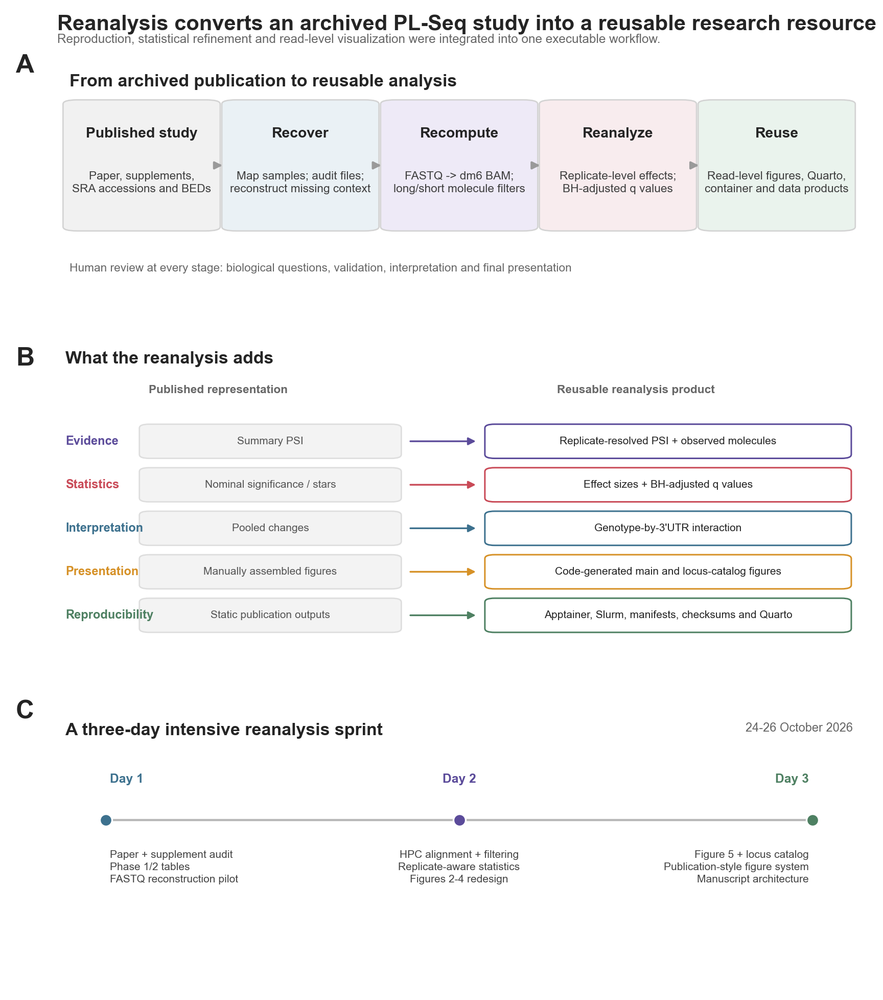
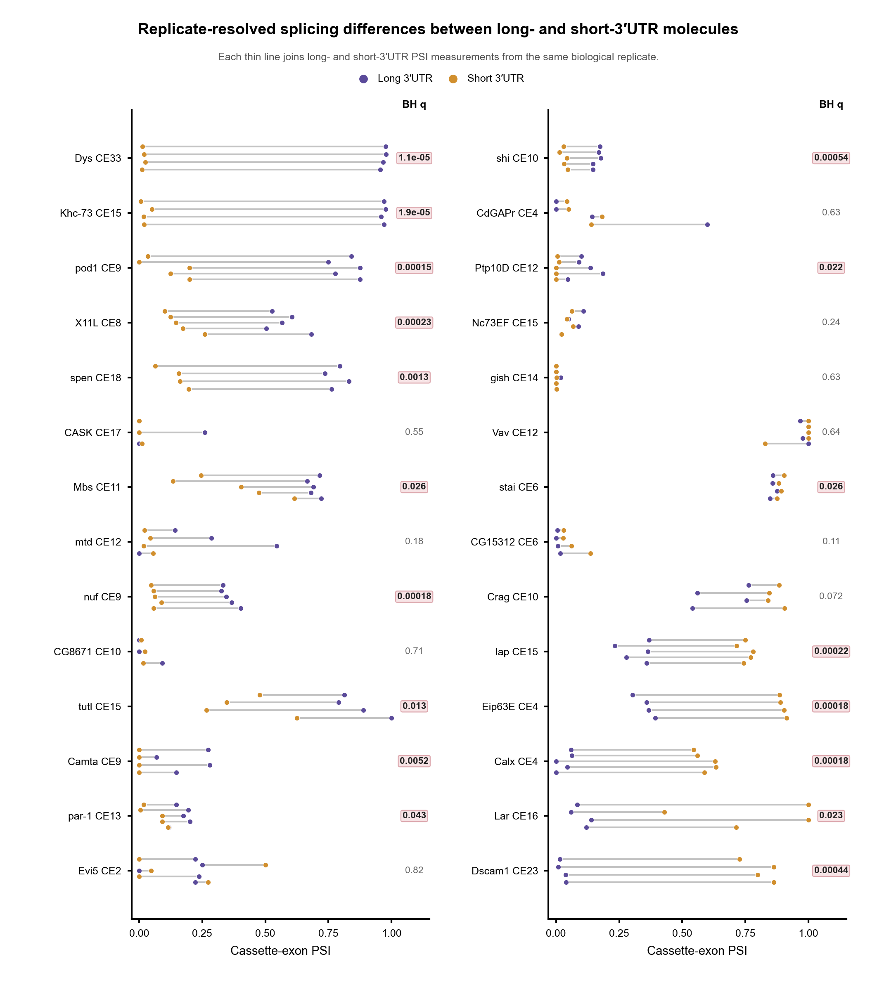
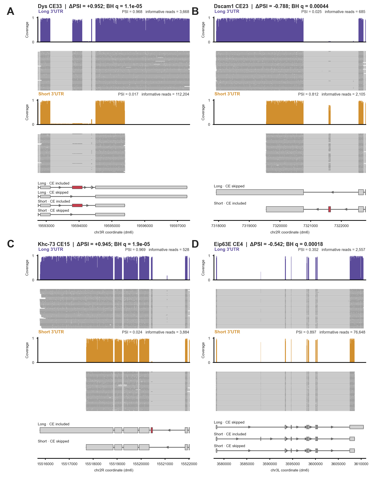
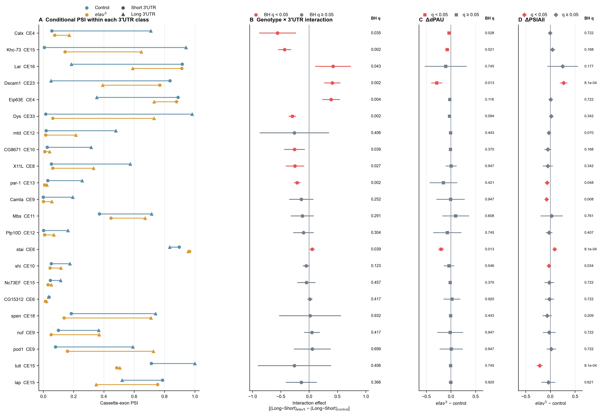
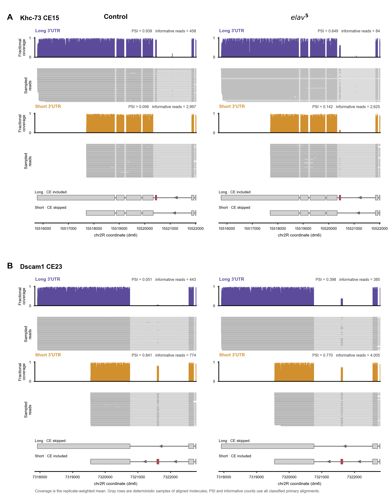

## Abstract

Targeted long-read RNA sequencing can connect alternative exons to alternative transcript ends on individual RNA molecules, but the resulting datasets remain difficult to audit, visualize, and reuse. We reanalyzed the Pull-a-Long-Seq (PL-Seq) study of cassette-exon splicing and alternative polyadenylation in *Drosophila melanogaster* [@zhang2023]. Starting from deposited source tables and archived sequencing reads, we reproduced reported percentage-spliced-in (PSI) estimates, reconstructed the original long- and short-3′UTR molecule classes, and rebuilt selected analyses from FASTQ files in a containerized high-performance-computing workflow. We then replaced nominal significance annotations with replicate-aware effect estimates and Benjamini–Hochberg-adjusted q values, developed read-level locus views that retain individual molecule structures, and reframed the Elav analysis as a genotype-by-3′UTR interaction. In 16–18-hour embryos, 18 of 28 cassette-exon events remained significant after correction across the 28 tested genes. Programmatic figures and a versioned manuscript source make the analysis directly rebuildable and expose both biological effects and analytical assumptions more clearly than static summary plots. This case study shows how reanalysis can convert an existing publication into a more useful experimental resource: one that supports inspection of individual molecules, more defensible inference, and extension to new long-read datasets.

## Introduction

Alternative transcription initiation, pre-mRNA splicing, and 3′-end processing are often studied as separate regulatory layers. Yet these decisions occur on the same nascent transcript and can be coordinated, producing recurring combinations of transcript starts, internal exons, and polyadenylation sites. Full-length long-read sequencing has made such connectivity directly observable [@anvar2018], and recent work has further shown that transcript initiation and termination choices can be spatially coordinated along genes [@calvor2025]. The biological unit of interest is therefore not only an isolated splice junction or polyadenylation site, but the combination of processing decisions present on a single RNA molecule.

Transcriptome-wide long-read RNA sequencing provides broad isoform discovery, but finite sequencing depth can limit quantitative analysis of selected genes and low-abundance isoforms. Targeted long-read approaches address this limitation by enriching defined transcripts before sequencing. PL-Seq uses antisense biotinylated probes to pull down selected full-length cDNAs, followed by PCR amplification and Oxford Nanopore sequencing [@zhang2023]. Enrichment concentrates sequencing capacity on genes of interest while preserving molecule-level connections between cassette exons and alternative 3′ ends. TEQUILA-seq, a contemporaneous capture-based method, independently demonstrated the broader utility and affordability of targeted long-read RNA sequencing [@wang2023]. Analytical principles developed here should therefore apply beyond PL-Seq to other hybridization- or pull-down-based long-read strategies.

The original PL-Seq study established that cassette-exon inclusion can differ between molecules using short and long 3′UTRs, and that Elav loss can affect these relationships [@zhang2023]. Its principal conclusions were presented largely through aggregate PSI values, nominal significance symbols, and selected summary graphics. Those choices were appropriate for demonstrating the method, but they leave opportunities for a more transparent secondary analysis. In particular, explicit correction across the tested event family improves control of false discoveries, while read-level displays make it possible to inspect the molecule structures underlying each PSI estimate.

Genome-browser screenshots are useful for exploration, but manual capture and subsequent editing do not necessarily preserve an executable record of the plotted interval, input files, scaling, and layout. pyGenomeTracks provides configuration-driven, reproducible visualization of genomic data and annotations [@lopezdelisle2021]. We used it to construct systematic locus views and to evaluate representative transcript models, then used BED12-aware custom rendering for final panels requiring sampled individual molecules, fixed multi-panel geometry, and embedded statistical summaries. This combination retains the reproducibility of programmatic genome tracks while permitting a publication-specific visual grammar.

Commercially accessible coding agents create a further opportunity to lower the practical barrier to such reanalysis. Codex was introduced as a cloud software-engineering agent in May 2025 and became generally available in October 2025 [@openai2025intro; @openai2025ga]. Paper2Agent subsequently formalized a related idea for scientific publications: converting papers, supplementary material, data, and code into interactive agent-accessible resources [@miao2026]. Here, Paper2Agent-supported organization was used for initial extraction and analytical triage, whereas the substantive reanalysis—HPC workflow development, containerization, debugging, statistical testing, visualization, and manuscript assembly—was carried out interactively with Codex under author review. We use this case study to evaluate not autonomous discovery, but whether an author-supervised agent workflow can make a published analysis faster to reconstruct, easier to interrogate, and more reusable.

## Results

### Reconstructing PL-Seq created an auditable starting point for statistical and visual reanalysis

Our first objective was to determine whether the PL-Seq results reported by Zhang *et al.* [@zhang2023] could be reconstructed closely enough to support new analyses rather than only redrawing the published figures. We therefore organized the work as a sequence of increasingly data-intensive stages (Figure 1A). We began with the deposited source tables, recalculating PSI as the number of cassette-exon inclusion reads divided by the total number of informative reads. Across 1,024 PL-Seq observations from the embryo, head, deletion-mutant, *elav*-mutant, and Endov datasets, recalculated PSI values agreed with the deposited values to within $10^{-8}$. Applying the published minimum of two informative reads also recovered the reported Figure 3 means and paired tests to rounding precision. This table-level audit established that the deposited count tables were internally consistent and provided a reference against which FASTQ-derived results could be checked.

We next reconstructed the alignment-level workflow for the embryo data. Public FASTQ files were linked to their run accessions and biological replicates, aligned to dm6, and separated into long- and short-3′UTR molecule classes using the flanking-exon, universal-UTR, and distal-UTR intervals used by the PL-Seq analysis. The computational environment was encapsulated with Apptainer, while Slurm manifests made each sample independently executable and restartable. At each filtering stage, BAM integrity, retained alignment counts, and final inclusion/total counts were recorded. The result was a chain from public accession to alignment, molecular class, event count, PSI estimate, and final panel rather than a collection of disconnected plotting inputs (Figure 1A).

This reconstruction also defined the specific improvements evaluated in the remainder of the study (Figure 1B). First, the source figures were extended from summarized PSI values to replicate-resolved measurements. Second, nominal significance symbols were replaced by effect sizes and Benjamini–Hochberg-adjusted q values. Third, aggregate summaries were linked back to individual aligned molecules and explicit transcript annotations. Finally, the analysis and figure layouts were converted into versioned scripts so that a change in filtering, annotation, or statistical criteria could be propagated without manual reassembly. The intensive audit, HPC reconstruction, statistical redesign, and figure-development phase occurred over three calendar days, 24–26 October 2026 (Figure 1C). This interval is reported as elapsed project time because active person-hours were not prospectively recorded.

::: {.figure-box}
{#fig-workflow width=100%}

**Figure 1. Reconstructing and extending a targeted long-read sequencing study.** A. The original publication and archived data were converted into a staged, executable reanalysis. B. The workflow improves auditability, statistical reporting, read-level evidence, and future reuse. C. Verified milestones during the intensive three-day reconstruction period. The duration represents elapsed calendar time, not prospectively measured person-hours; download and HPC compute times varied among samples.
:::

### Replicate-resolved visualization and multiple-testing correction refine the 16–18-hour embryo result

In the original manuscript, the 16–18-hour embryo analysis showed that cassette-exon inclusion frequently differed between molecules connected to long and short 3′UTRs [@zhang2023]. However, displaying group summaries with significance stars made it difficult to evaluate replicate consistency, effect direction, and the statistical consequence of testing 28 events. We therefore rebuilt this comparison with one paired line per biological replicate (Figure 2). The long- and short-3′UTR observations from the same library are connected, the assayed cassette exon is included in each gene label, and the published gene order is retained. The neutral connecting lines deliberately carry no significance encoding; instead, the exact BH-adjusted q value is reported beside each event, with a pale-red highlight used only when q < 0.05.

The replicate-resolved view showed that the largest effects were not produced by isolated samples. *Dys* CE33 and *Khc-73* CE15 were almost completely included among long-3′UTR molecules but rarely included among short-3′UTR molecules, yielding mean long-minus-short PSI differences of 0.952 and 0.945, respectively (Figure 2). The same direction of association extended across *pod1*, *X11L*, *spen*, *Mbs*, *nuf*, *CG8671*, *tutl*, *par-1*, *shi*, and *Ptp10D*. The opposite configuration was observed for six significant events: *stai*, *lap*, *Eip63E*, *Calx*, *Lar*, and *Dscam1*. The strongest inverse event was *Dscam1* CE23, for which mean PSI was approximately 0.03 among long-3′UTR molecules and 0.81 among short-3′UTR molecules.

Twenty of the 28 paired comparisons had nominal *P* < 0.05, whereas 18 remained significant after BH correction across the complete event family (Figure 2). Twelve of these 18 events showed higher exon inclusion on long-3′UTR molecules and six showed higher inclusion on short-3′UTR molecules. *Camta* and *Crag* passed the nominal threshold but not the adjusted threshold (q = 0.053 and 0.067, respectively), illustrating why the original star-based display and the multiplicity-aware display should not be interpreted interchangeably. Conversely, several modest mean differences remained supported because they were consistent across replicates, including *stai* (ΔPSI = -0.028, q = 0.027) and *Ptp10D* (ΔPSI = 0.108, q = 0.022). Thus, multiple-testing correction reduced the number of supported events only modestly while providing a clearer separation between effect magnitude and statistical evidence.

::: {.figure-box}
{#fig-replicates width=100%}

**Figure 2. Replicate-resolved cassette-exon inclusion in long- and short-3′UTR molecules from 16–18-hour embryos.** Each paired line connects PSI estimates from the same biological replicate. Genes are labeled with the assayed cassette exon. Benjamini–Hochberg q values were calculated across the 28 paired comparisons; significant q values are highlighted without changing the replicate-line colors.
:::

### Read-level locus views reveal the transcript structures underlying opposing PSI relationships

The original study used long-read sequencing precisely because individual PL-Seq molecules preserve connectivity between internal exons and transcript ends [@zhang2023]. Although Figure 2 establishes the magnitude and reproducibility of each association, PSI alone does not show the read structures from which inclusion and skipping were counted. Conventional coverage tracks are also insufficient for this purpose: coverage can identify highly sequenced regions but collapses the exon connectivity that motivates long-read sequencing. We therefore generated a second visualization layer in which fractional coverage and individual sampled molecules are displayed separately for the long- and short-3′UTR classes (Figure 3). Reads are uniformly gray so the relevant visual signal is the presence or absence of the cassette-exon block, rather than an assigned read color. Underneath the observed molecules, representative dm6 transcript structures provide genomic context. Only transcript combinations present in the reference annotation are displayed; an unannotated experimental combination is not converted into a hypothetical model.

The read-level views make the two major directions of coupling visually explicit. For *Dys*, long-3′UTR molecules overwhelmingly contain CE33, whereas the corresponding block is generally absent from short-3′UTR molecules (ΔPSI = 0.952, q = $1.1\times10^{-5}$; Figure 3A). *Khc-73* CE15 shows a closely related pattern (ΔPSI = 0.945, q = $1.9\times10^{-5}$; Figure 3C). These panels also show that the apparent separation is not simply a change in average coverage: exon inclusion or skipping can be traced across individual aligned molecules and the required flanking regions.

The inverse relationship is represented by *Dscam1* and *Eip63E*. *Dscam1* CE23 is largely skipped among long-3′UTR molecules but included among short-3′UTR molecules (ΔPSI = -0.788, q = 0.00044; Figure 3B). *Eip63E* CE4 similarly shows greater inclusion in the short-3′UTR class (ΔPSI = -0.542, q = 0.00018; Figure 3D). Together, these examples demonstrate that the long-versus-short association is not a uniform bias toward exon inclusion on one transcript class. Instead, individual genes adopt distinct, reproducible exon/3′UTR combinations. The same rendering procedure was extended to all 28 loci in the supplemental catalog, allowing the summarized result in Figure 2 to be audited gene by gene without duplicating that statistical panel in Figure 3.

::: {.figure-box}
{#fig-loci width=100%}

**Figure 3. Read-level evidence for selected cassette-exon/3′UTR relationships.** Individual-molecule and annotation views are shown for A. *Dys* CE33, B. *Dscam1* CE23, C. *Khc-73* CE15, and D. *Eip63E* CE4. Long- and short-3′UTR coverage and sampled molecules are displayed separately. Mean PSI and the total number of informative primary alignments across biological replicates are reported for each molecule class. Gray alignment blocks preserve the observed cassette-exon inclusion or skipping pattern; displayed rows are deterministic samples, whereas PSI and informative-read counts use all classified primary alignments. Transcript models are representative dm6 annotations, not inferred transcripts.
:::

### A genotype-by-3′UTR interaction identifies loss of conditional splicing relationships in *elav* mutants

The original manuscript found that ELAV-dependent splicing changes could differ between transcripts using alternative 3′UTRs and presented pooled, long-3′UTR, and short-3′UTR PSI measurements alongside distal polyadenylation usage [@zhang2023]. We revisited this result by asking a more direct question: does loss of ELAV change the *relationship* between cassette-exon inclusion and 3′UTR identity? A change in pooled PSI tests whether overall exon inclusion differs between genotypes, while separate tests within long- or short-3′UTR molecules ask whether one subset changes. Neither directly tests whether genotype alters the difference between the two molecule classes. We therefore introduced a genotype-by-3′UTR interaction for each event, defined as $(PSI_{long}-PSI_{short})_{elav^5}-(PSI_{long}-PSI_{short})_{control}$. This difference-in-differences metric preserves the defining information supplied by PL-Seq: which cassette-exon decision is connected to which 3′UTR on the same molecules.

Figure 4A displays the four conditional means that form this interaction, with color denoting genotype and marker shape denoting 3′UTR class. Widely separated circle and triangle positions indicate strong coupling between exon inclusion and 3′UTR choice. Movement of those positions toward one another in *elav^5* indicates that the association weakens, even if the overall mean PSI changes little. This visualization therefore reframes the phenotype from “does exon inclusion change?” to “does genotype alter how exon inclusion depends on 3′UTR identity?”

Formal interaction testing supported this visual pattern for 10 events after BH correction: *Calx*, *Khc-73*, *Lar*, *Dscam1*, *Eip63E*, *Dys*, *CG8671*, *X11L*, *par-1*, and *stai* (Figure 4B). For each of these events, the absolute separation between long- and short-3′UTR PSI decreased in *elav^5*. The direction of the signed interaction depended on the control configuration. For example, positive long-minus-short relationships weakened for *Calx*, *Khc-73*, *Dys*, *CG8671*, *X11L*, and *par-1*, producing negative interaction estimates. Conversely, the strong short-biased relationships of *Dscam1*, *Eip63E*, and *Lar* became less negative, producing positive estimates. The shared result is therefore convergence of the two molecule classes rather than a common shift toward exon inclusion or exon skipping.

The interaction view also revealed that *Khc-73* is not an isolated example of a genotype-dependent long-versus-short PSI difference. For *Khc-73*, the long-minus-short PSI separation decreased by 0.432 in *elav^5* (interaction q = 0.0023; Figure 4B), whereas pooled PSI did not change significantly (ΔPSIAll = 0.041, q = 0.168; Figure 4D). *Calx* provides an even clearer illustration of why the interaction is a distinct metric: its conditional separation decreased by 0.557 (interaction q = 0.035), but its pooled PSI was essentially unchanged (ΔPSIAll = -0.004, q = 0.722). For *Lar*, the strongly negative long-minus-short relationship moved toward zero by 0.423 (interaction q = 0.043), while neither pooled PSI (q = 0.177) nor distal polyadenylation usage (q = 0.745) changed significantly. In each case, collapsing the two 3′UTR classes into one PSI value obscures the genotype-dependent reorganization that is evident when molecule identity is retained.

We then examined this relationship alongside the two marginal measurements used in the original analytical framework [@zhang2023]. Distal polyadenylation usage (dPAU) is the fraction of a gene's conventional RNA-seq signal assigned by QAPA to its distal polyadenylation site, rather than a count of PL-Seq molecules classified as long 3′UTR. Here, $\Delta$dPAU is defined as dPAU in *elav^5* minus dPAU in control. A positive value therefore indicates increased relative use of the distal site in the mutant, consistent with 3′UTR lengthening, whereas a negative value indicates decreased distal-site use, consistent with shortening. Figure 4C shows this continuous change, its uncertainty, and a BH-adjusted q value, rather than treating APA as only a binary altered/unaltered annotation.

Significant $\Delta$dPAU values were observed for four genes—*Calx*, *Khc-73*, *Dscam1*, and *stai*—after BH correction (Figure 4C). Pooled PSI changed significantly for six genes: *Dscam1*, *par-1*, *Camta*, *stai*, *shi*, and *tutl* (Figure 4D). Several strong interactions, including those for *Dys*, *Eip63E*, *CG8671*, *X11L*, and *Lar*, were not accompanied by a significant change in either marginal summary. Conversely, *Camta*, *shi*, and *tutl* changed in pooled PSI without a significant interaction. Thus, $\Delta$dPAU asks whether the relative use of the distal polyadenylation site changes, pooled $\Delta$PSI asks whether overall exon inclusion changes, and the interaction asks whether genotype reorganizes exon inclusion *between* the two 3′UTR classes. These are related but non-equivalent biological measurements. The associations do not establish direct ELAV action.

::: {.figure-box}
{#fig-elav width=100%}

**Figure 4. ELAV-dependent cassette-exon splicing analyzed in relation to 3′UTR choice.** A. Conditional mean PSI values for control and *elav* mutant 16–18-hour embryos; circles denote short-3′UTR molecules and triangles denote long-3′UTR molecules. B. Event-level genotype-by-3′UTR interaction effects test whether ELAV loss changes the long-minus-short PSI relationship; horizontal bars show 95% Welch confidence intervals. Genes are ordered by the change in the absolute long-minus-short PSI separation. C. Change in distal polyadenylation usage ($\Delta$dPAU = QAPA-derived dPAU in *elav* mutant minus control). Positive values indicate increased relative distal-site use and negative values indicate decreased distal-site use. D. Change in pooled cassette-exon PSI between *elav* mutant and control. Benjamini–Hochberg correction was applied separately within each metric family. Red denotes q < 0.05; gray denotes q ≥ 0.05.
:::

### Individual molecules substantiate genotype-dependent changes in exon–3′UTR coupling

The interaction analysis in Figure 4 summarizes replicate-level PSI relationships but does not itself show the aligned molecules that produce those estimates. We therefore reconstructed matched read-level views for *Khc-73* CE15 and *Dscam1* CE23, the two loci displayed as examples in the original ELAV analysis [@zhang2023]. Control and *elav^5* samples are shown on the same genomic scale, with long- and short-3′UTR molecules separated before coverage and individual-read rendering (Figure 5). Mean fractional coverage gives each of the four biological replicates equal weight, while the reported PSI values and informative-read counts use all classified primary alignments. The gray read rows are deterministic display samples and are not the denominator of the statistical analysis.

For *Khc-73*, control long-3′UTR molecules strongly included CE15 (mean PSI = 0.939; 458 informative reads), whereas short-3′UTR molecules rarely included it (mean PSI = 0.006; 2,997 informative reads; Figure 5A). In *elav^5*, long-3′UTR PSI decreased to 0.649 (84 informative reads) while short-3′UTR PSI increased to 0.142 (2,625 informative reads). The two molecule classes therefore moved toward one another, visually substantiating the negative interaction estimate in Figure 4B rather than suggesting a uniform loss or gain of exon inclusion.

*Dscam1* showed the inverse control configuration. CE23 inclusion was low among control long-3′UTR molecules (mean PSI = 0.051; 443 informative reads) and high among short-3′UTR molecules (mean PSI = 0.841; 774 informative reads; Figure 5B). In *elav^5*, long-3′UTR PSI increased to 0.398 (385 informative reads), whereas short-3′UTR PSI remained comparatively high at 0.770 (4,005 informative reads). Thus, the positive interaction estimate reflects selective movement of the long-3′UTR class toward the short-3′UTR state. Together, these loci demonstrate why the interaction is most naturally interpreted as altered coupling between exon choice and transcript-end identity.

::: {.figure-box}
{#fig-elav-reads width=100%}

**Figure 5. Read-level evidence for altered cassette-exon/3′UTR coupling in *elav* mutants.** Control and *elav^5* 16–18-hour embryos are compared for A. *Khc-73* CE15 and B. *Dscam1* CE23. Long- and short-3′UTR molecule classes are displayed separately using replicate-weighted mean fractional coverage and deterministic samples of individual alignments. Mean PSI and informative primary-alignment counts are calculated from all four biological replicates, not from the displayed read samples. Reads are gray so cassette-exon inclusion or skipping is conveyed by alignment structure. Representative transcript models are real dm6 annotations; red blocks mark the assayed cassette exon.
:::

## Discussion

This reanalysis supports the central conclusion of the original study: cassette-exon inclusion is frequently associated with alternative 3′UTR choice on individual RNA molecules, and Elav-dependent regulation can differ between molecule classes [@zhang2023]. Its main contribution is not to replace the original biology, but to make the evidence easier to inspect and the inference more explicit.

Benjamini–Hochberg adjustment is an important improvement over interpreting 28 nominal tests independently. It controls the expected false-discovery proportion among rejected hypotheses and makes the inferential family visible to the reader. Exact q values also communicate evidential strength more clearly than stars. Replicate-resolved graphics provide an equally important improvement: they show whether a mean difference is supported consistently across samples and reveal where limited counts or dispersion warrant caution.

The genotype-by-3′UTR interaction provides a new way to interpret regulatory effects in molecule-resolved data. Pooled ΔPSI asks whether exon inclusion changes across all molecules, but the interaction asks whether genotype changes the dependence of exon inclusion on transcript-end choice. *Calx* and *Lar* demonstrate why this distinction matters: both show significant changes in conditional long-versus-short PSI despite nonsignificant pooled PSI changes, and *Lar* also lacks a detectable marginal APA change. These are not contradictory results. They show that the relative allocation of exon-included and exon-skipped molecules between alternative 3′UTR classes can be reorganized without producing a large change in the pooled transcript population. This interaction framework should be useful for other targeted or transcriptome-wide long-read datasets that retain multiple processing decisions on individual molecules.

Read-level visualization turns aligned molecules into an analytical object rather than a hidden intermediate. In the original paper, most conclusions after the methodological demonstration were communicated through summarized measurements. Figure 3 and Supplementary Figure 1 connect the 16–18-hour embryo summary back to the exon blocks and transcript ends that produced it, while Figure 5 applies the same visual grammar to genotype-dependent effects. This is particularly valuable in targeted long-read experiments, where the purpose of enrichment is to recover molecule connectivity. Configuration-driven tools such as pyGenomeTracks, combined here with explicit BED12 rendering for specialized panels, allow the same locus views to be regenerated when annotations, filters, or samples change. Programmatic genome-track generation is therefore part of the audit trail, not merely a cosmetic endpoint.

The reconstructed resource also creates a practical starting point for new experiments. Exact loci and event definitions can be applied to newer direct-RNA sequencing datasets, alternative transcript quantifiers, or updated annotations. The same long/short classification and event-counting logic can be stress-tested against isoform-level assignments rather than recreated from a figure. Reanalysis thus yields something more useful than a visual reproduction: it produces an extensible assay catalog, a set of validated computational decisions, and a framework for comparing related datasets.

The speed of the intensive reconstruction illustrates the potential of author-supervised coding agents, but it should not be interpreted as autonomous scientific validation. Paper2Agent helped structure the publication and identify reusable inputs; Codex accelerated scripting, HPC orchestration, debugging, statistical implementation, and figure iteration. The author supplied biological interpretation, resolved ambiguous annotations, selected scientifically appropriate comparisons, and reviewed outputs. All agent-generated code and claims therefore remain subject to ordinary scientific verification. The most consequential advantage was ease of iteration: a change to an event definition, statistical rule, or layout could be propagated through scripted outputs instead of manually rebuilding composite figures.

Several limitations remain. The reanalysis depends on deposited reads, metadata, interval definitions, and the quality of dm6 transcript annotations. Some transcript combinations observed experimentally may not have a matching annotated model. Read filtering and classification are operational definitions and should not be confused with complete isoform reconstruction. Finally, the project timeline was reconstructed from file and job records rather than prospective time tracking. These limitations are made explicit in the generated QC and provenance records.

## Methods

### Source study and data acquisition

The analysis reexamined PL-Seq data from Zhang *et al.* [@zhang2023]. Original FASTQ files were obtained from the public accessions reported by the study. Source-data tables were used to verify sample identities, replicate structure, cassette-exon coordinates, published PSI values, and reported comparisons. A machine-readable manifest linked each run accession to its biological group, probe set, replicate, FASTQ, aligned BAM, and downstream outputs.

### Computational environment and alignment

HPC analyses were executed through Slurm on the Mantis cluster. Apptainer containers preserved the required command-line environment and were identified by cryptographic checksum. Reads were aligned to the dm6 reference with minimap2 v2.17, matching the established reconstruction workflow, and coordinate-sorted/indexed with samtools. Exact commands, resource requests, image definition, software versions, and manifests will be released with the code repository.

### Molecule classification and PSI calculation

Aligned molecules were filtered sequentially using reconstructed flanking-exon intervals, universal 3′UTR intervals, and distal 3′UTR intervals. Long-3′UTR molecules overlapped the distal interval after satisfying the upstream, downstream, and universal-UTR requirements. Short-3′UTR candidates were constructed as the non-distal complement and subjected to the published poly(A)-filtering logic. Cassette-exon PSI was calculated as inclusion-supporting informative molecules divided by all informative molecules for each event and molecule class. Intermediate and final BAM files were validated, and per-stage alignment counts were retained as QC output.

### Statistical analysis

For the 16–18-hour embryo comparison, long- and short-3′UTR PSI estimates were paired within biological replicate for each of 28 cassette-exon events. Two-sided paired tests reproduced the original analysis, and Benjamini–Hochberg adjustment was applied across the 28-event family. Effect sizes and confidence intervals were reported alongside nominal *P* values and adjusted q values. Elav-dependent effects were additionally analyzed using a genotype-by-3′UTR interaction framework, with multiplicity adjustment applied within each defined analysis family. Missing or non-estimable comparisons were retained as such rather than converted to zero.

### Reproducible genomic visualization

Genomic intervals and transcript annotations were derived from the dm6 reference resources used in the reconstruction. pyGenomeTracks [@lopezdelisle2021] was used for reproducible locus-track construction and transcript-annotation prototyping. Final individual-molecule panels were rendered from alignment-derived BED12 and coverage inputs with custom Python/Matplotlib scripts because they required deterministic molecule sampling, separate long/short tracks, fixed panel geometry, and integrated PSI/q-value labels. Transcript models were binned by annotated cassette-exon inclusion and 3′UTR class; one real annotation was selected per represented combination, and unsupported combinations were omitted.

### AI-assisted workflow and verification

Paper2Agent [@miao2026] was used during initial publication parsing and Phase 1/2 analytical triage. Codex was used interactively for code generation and revision, shell/HPC workflow construction, error diagnosis, statistical and graphical implementation, and manuscript assembly. The author reviewed commands before execution, inspected tabular and graphical outputs, resolved biological and annotation questions, and directed all analytical decisions. Generated outputs were checked using syntax validation, BAM integrity tests, count reconciliation, comparison with deposited source values, and visual inspection. AI assistance did not replace author responsibility for the analysis or conclusions.

## Data Availability

The original FASTQ files are already deposited in public sequence archives; run accession numbers and sample metadata will be provided in the final accession table. Large FASTQ, BAM, container-image, and intermediate files will not be duplicated in the manuscript submission or GitHub repository. They can be reconstructed from the public reads and versioned workflow.

## Code Availability

The reanalysis repository will contain scripts, Quarto source, Slurm templates, small source/result tables, manifests, the Apptainer definition file, software versions, and container checksum. A permanent repository URL and archived release identifier will be added before submission.

## References

::: {#refs}
:::

## Acknowledgements

This work is supported by NIGMS grant R35GM138319 awarded to P.M.

## Author Contributions

P.M. conceived and supervised the reanalysis, curated and interpreted the data, directed the computational and statistical work, reviewed all outputs, and wrote the manuscript with AI-assisted computational and editorial support.

## Competing Interests

The author declares no competing interests.

## Supplementary Information

Supplementary Figure 1 presents the read-level locus catalog for all 28 cassette-exon events. Additional supplements will report per-stage QC, count reconciliation, sensitivity analyses, the complete event-level statistical tables, and annotation/provenance audits.
